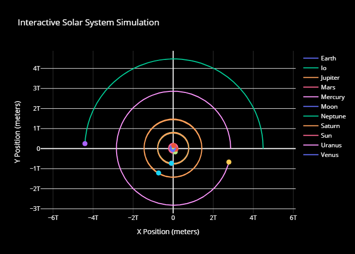

# N-Body Solar System Simulator 🪐

A physics-based simulation of the Solar System written in C++ and visualized interactively in Python. The engine uses Semi-implicit Euler integration to calculate real-time gravitational perturbations between planets and moons.



## Features
* **C++ Physics Engine:** Calculates N-body gravitational interactions using real astronomical data (masses, velocities, and AU scaling).
* **Python/Plotly Visualization:** Interactive web-based 2D render of the orbits with zoom and pan capabilities.
* **Complex Orbital Mechanics:** Demonstrates stability in sub-systems like Earth-Moon and Jupiter-Io over long simulation periods.

## Requirements
* GCC / G++ compiler (C++11 or higher)
* Python 3.x
* Python libraries: `pandas`, `plotly`

## Usage
1. Compile the C++ engine:
   ```bash
   g++ *.cpp -o simulator
2. Run the simulation (this will generate a trajectories.csv):
    ```./simulator
3. Launch the interactive visualization:
    ```python plot.py
    
